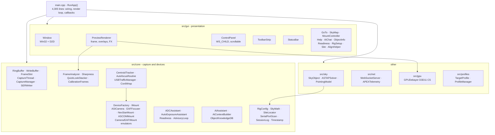

# Architecture Overview

One process, one `RunApp()` function, six threads, and a strict rule about
which thread may touch what. Everything else follows from the throughput
requirement: ~1.5 GB/s off USB3 while displaying a preview, computing
quality metrics, and writing to disk, without dropping frames.

---

## Layer map



**`main.cpp` is the composition root, deliberately.** All device objects,
threads, panels, and callbacks are locals of `RunApp()`, wired together by
lambdas. There is no service locator, no dependency injection container,
and no global application object (the only file-scope state is the crash
log handle and a mount pointer the crash handler needs to issue an
emergency stop). The cost is a 4,305-line function. The benefit is that
object lifetimes are lexically obvious and shutdown order is the reverse
of construction order, for free.

**Most of `src/core` is header-only.** Only nine translation units compile:
`main.cpp`, the three device wrappers (hardware build only),
`CaptureThread`, `CaptureManager`, `SERWriter`, `WriteBuffer`,
`FrameAnalyzer`, `CentroidTracker`, `USBTrafficManager`, plus
`Window`/`PreviewRenderer`/`ControlPanel` and the two `net` files.
Everything else is `#pragma once` headers included into `main.cpp`.

---

## Window architecture

Three-tier child window layout. All elements are children of the main
window — nothing bleeds or overlaps.

```
Main Window  (WS_OVERLAPPEDWINDOW | WS_CLIPCHILDREN, dark bg brush)
├── ToolbarStrip     WS_CHILD  x=0            y=0   w=clientW-560  h=30
├── NotificationBar  WS_CHILD  (0 or NOTIF_HEIGHT, folded into layout)
├── Preview Child    WS_CHILD  x=0            y=30  w=clientW-580  h=clientH-30
│     └── D2D HwndRenderTarget — live preview, overlays, reticle, HUD, status bar
├── ControlPanel     WS_CHILD  x=clientW-560  y=0   w=560          h=clientH  WS_VSCROLL
└── [Gap strip]      filled by the main window background brush
```

> **Why it is this way — D2D lives in the preview child, not the main
> window.** The OS clips D2D output to the child's bounds automatically.
> No `PushAxisAlignedClip`, no offset transforms, no gap-fill hacks, and
> the reticle is no longer off-centre or clipped by a toolbar transform.
> The preview is a true bounded box, and `y=0` means "below the toolbar".
> Before this, D2D bled over the control panel.

A handful of Win32 details in this layout were each a bug once, and the
fixes are load-bearing:

| Detail | Why |
|--------|-----|
| `WS_CLIPCHILDREN` on the main window | OS skips painting child areas — no flicker |
| `SS_OWNERDRAW \| SS_NOTIFY` on section headers | `SS_NOTIFY` is **required** for owner-drawn statics to receive `WM_LBUTTONDOWN` |
| `WM_SIZE` guard `if (m_contentBottom < 1) break` | `WM_SIZE` fires before `RebuildControls`; without the guard the scroll range is bogus |
| Layout width `clientW - 10 - SM_CXVSCROLL - 2` | Reserves the scrollbar so controls do not draw behind it |
| `m_cachedProfileNames` survives `RebuildControls` | Otherwise the profile combo is empty after any collapse/expand |
| `UpdateStates` state cache in the toolbar | Prevents 38 fps `SetWindowTextW` calls, which made the buttons flash |
| `SetWindowSubclass` + `IsDialogMessageW` for modals | A hand-rolled `GetMessage` loop never received `WM_COMMAND`, so the profile editor froze |
| Both main window **and** panel `EnableWindow(FALSE)` during a modal | Otherwise `PanelWndProc` forwards arrow keys and **jogs the mount** while a dialog is open |

The last one is a safety issue rather than a cosmetic one, and it is worth
noting the pattern: several Win32 details here are guarding against
accidentally commanding a telescope.

---

## Data flow, one render tick

The render loop at
[`src/main.cpp:3320`](https://github.com/Maligzar/Raduk-Capture/blob/master/src/main.cpp#L3320)
documents its own frame order:

```
1. mount->Heartbeat()                       feed the runaway watchdog, every frame
2. ring.GetLatestFrame()                    newest READY slot, now held as READING
3. calib.AddFrame()        if building      master dark/flat, BEFORE the gate
4. capturer.SubmitFrame()  if recording     subject to the quality gate
5. analyzer.Submit()       always           non-blocking; skipped if busy
6. RenderFrame() + overlays + StatusBar + EndFrame()
7. ring.ReleaseRead()                       slot returns to FREE
```

Plus, every 500 ms, gated readouts: focuser position and temperature, mount
RA/Dec/Alt/Az, disk space, status bars, session accumulators, and a
telemetry broadcast. Polling is throttled during capture by
[`USBTrafficManager`](Device-Layer#usb-arbitration).

Two ordering decisions in that list carry reasoning:

**Calibration master building happens before the quality gate.** A master
is built from what the sensor reports and must not be filtered by a gate
meant for pictures of planets.

**Analyzer submission is non-blocking and lossy by design.** If the
analyzer thread is still working on the previous frame, the new frame is
dropped. You always want the latest result, never a queue of stale work.

---

## The ownership rules

These are the invariants that keep the pipeline sound. Breaking any one of
them has caused a real bug in this codebase.

| Rule | Enforced by |
|------|-------------|
| A slot handed to a consumer is `READING` and will not be overwritten | CAS transitions in `RingBuffer`; see [Capture Pipeline](Capture-Pipeline) |
| Every `GetLatestFrame()` must be matched by `ReleaseRead()` | Caller discipline in the render loop |
| `CentroidTracker` shared state passes through one mutex, read by the correction thread only via `Snapshot` | `GetSnapshot()` |
| `SubmitCentroid()` is called **once per new analysis result** | Re-submitting a stale result refreshes the 2 s loss timeout and inflates the stable/dwell counters |
| No Win32 UI calls from a worker thread | Callbacks fired from the autofocus and tracker threads `PostMessage` or set atomics |
| `winsock2.h` before `windows.h` | `WIN32_LEAN_AND_MEAN` plus include ordering in `main.cpp` |
| The mount gets an emergency stop on crash and on exit | `CrashHandler` / `EmergencyStopOnExit` in `main.cpp` |

That last row deserves attention. `main.cpp` installs an
`UnhandledExceptionFilter` and an `atexit` handler, both of which stop the
mount. A crash that leaves a telescope slewing into its own fork is a
hardware-damage event, so stopping it is not left to the normal shutdown
path.

---

## Key design decisions

Condensed from §4 of the architecture document, with the reasoning kept:

| Decision | Rationale |
|----------|-----------|
| Lock-free ring buffer | The capture thread must never block on mutex contention |
| `READING` state in the slot machine | Prevents use-after-free when the GUI holds a slot during render |
| RAM-first write buffer | Decouples disk I/O latency from the capture thread |
| NexStar direct, no ASCOM/CPWI | Faster, no COM/registry dependencies, all commands available including `Mg/Me/Ms/Mw` |
| Fire-and-forget slew/stop commands | `SendCommandNoWait` avoids a serial round trip per correction cycle; deferred `#` acks are counted and drained before the next synchronous command. Note `PulseGuide` itself **blocks** on the NexStar backend — see [Mount Control](Mount-Control#pulseguide) |
| D2D in the preview child HWND | Zero bleed; the OS does the clipping |
| `WS_CHILD` control panel | Always docked, moves with the main window, no separate title bar |
| Sky map click-to-confirm | Prevents accidental slews from a fat-finger click on the map |
| 15° horizon floor | Site obstruction margin — `SLEW` is not offered below it |
| Quality gate on seeing threshold | Only records frames meeting a minimum seeing score |
| Compile-time device selection | A build is unambiguously hardware or emulator, never a mix |

---

## Memory footprint

| Configuration | Bytes per frame | Preview ring (64 slots) | Write buffer (512 slots) |
|---------------|-----------------|-------------------------|--------------------------|
| Full res RAW16 (3840×2160×2) | ~16.6 MB | ~1.06 GB | ~8.5 GB (not used at this size) |
| Planetary ROI RAW8 (1280×960) | ~1.2 MB | ~77 MB | ~600 MB |

Frame memory is allocated with `VirtualAlloc` — page-aligned, and it avoids
fragmenting the heap with multi-megabyte blocks that are allocated once and
held for the session.

At 47 fps × 1.2 MB = ~56 MB/s sustained. 512 write slots absorb roughly
**10 seconds** of complete disk stall before the buffer overruns.

---

**Next:** [Threading Model](Threading-Model) · [Capture Pipeline](Capture-Pipeline) · [Code Map](Code-Map)
