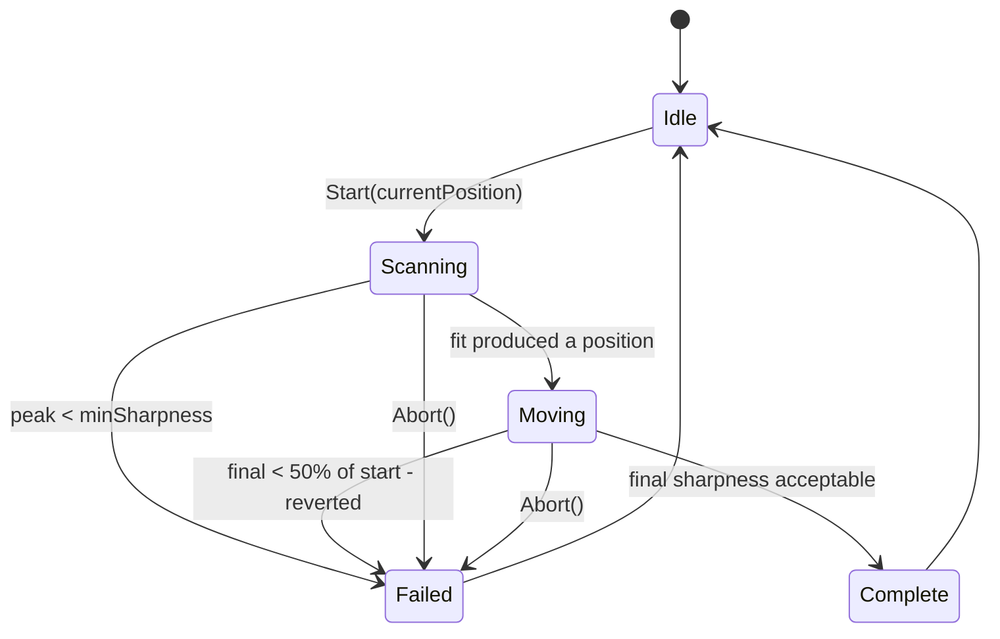

# Autofocus

A V-curve scan of the EAF with a local three-point parabola fit, a backlash
approach, and — the part that makes it trustworthy — a re-measurement
afterwards that reverts the move if it made focus worse.

[`src/core/AutofocusRoutine.h`](https://github.com/Maligzar/Raduk-Capture/blob/master/src/core/AutofocusRoutine.h)

---

## The algorithm

```
1. Sweep the EAF across SCAN_RANGE steps in N_STEPS positions
2. At each position: settle, then average FRAMES_PER_STEP sharpness samples
3. Fit a parabola to the peak sample and its two neighbours
   (fall back to a global least-squares fit, then to raw maximum)
4. Drive to the fitted peak, approaching from one side to take up backlash
5. Re-measure sharpness there and compare with the start
6. If it got clearly worse, go back to the start and report failure
```



---

## Parameters

```cpp
struct AutofocusParams {
    int   scanRange     = 6000;   // total steps swept (+/-3000 from start)
    int   nSteps        = 11;     // sample positions (odd preferred)
    int   framesPerStep = 8;      // sharpness samples averaged per position
    int   settleMs      = 600;    // wait after the EAF stops moving
    int   backlash      = 200;    // steps of compensation on the final move
    float minSharpness  = 2.0f;   // abort if the peak never exceeds this
    int   maxStepBound  = 600000; // EAF physical range
    int   minStepBound  = 0;
};
```

> **Why these numbers.** Tuned for the ZWO EAF on a Celestron 8SE at f/10.
> The 8SE has ~2000 steps/mm of focus travel at this f-ratio, and at typical
> planetary seeing the focus zone is ±500–1000 steps. A ±3000-step sweep
> with 11 positions gives 600-step spacing — coarse enough to cover the
> range, fine enough to find the peak.

**It takes about a minute, and that is correct.** Each position waits for 8
*genuinely new* measurements at the analyzer's own ~2 Hz rate, which is
what makes the curve fittable rather than seeing noise.

---

## The fit

### Preferred: three-point parabola around the peak

```cpp
int bestPos = FitPeakWindow();           // local, preferred
if (bestPos < 0) bestPos = FindBestPosition();   // global least squares
if (bestPos < 0) { /* fall back to raw maximum sample */ }
```

> **Why local beats global here.** A defocus curve is **not a parabola**: it
> has a sharp peak and long shallow tails, and a global least-squares fit
> across all 11 samples is dragged by the tails. Measured against a known
> true focus of 51,500, the global fit returned **52,224 — 724 steps out,
> against a sample spacing of 600.** Three points around the peak use only
> the region where a parabola is actually a good local model.

The fit uses divided differences, which tolerate the slightly uneven
spacing that integer position rounding leaves:

```cpp
const double d1 = (y2 - y1) / (x2 - x1);
const double d2 = (y3 - y2) / (x3 - x2);
const double a  = (d2 - d1) / (x3 - x1);
const double b      = d1 - a * (x1 + x2);
const double vertex = -b / (2.0 * a);
```

### Three conditions that reject the local fit

Each returns `-1` and falls back, and each is logged with a reason:

| Condition | Meaning |
|-----------|---------|
| Peak at either end of the sweep | **Focus is not bracketed at all.** `m_notBracketed` is set and the user is told to scan wider or recentre |
| `a >= -1e-12` (not concave at the peak) | That is noise, not a peak |
| Vertex outside the bracketing interval `[x1, x3]` | The samples are internally inconsistent |

A fit that refuses to answer is more useful than one that always answers,
because the fallback path is strictly better informed than a confident
wrong number.

---

## Backlash approach

```cpp
if (m_params.backlash > 0) {
    int approachFrom = finalPos - m_params.backlash;   // clamped to minStepBound
    m_focuser->MoveTo(approachFrom);
    WaitForMove();
    Sleep(300);
}
m_focuser->MoveTo(finalPos);
```

Always approach from **below**, in the same direction, for repeatability.
Mechanical backlash means the position reached depends on the direction of
travel; approaching consistently removes that as a variable.

---

## The revert, which is the point

```cpp
const float REGRESSION_FRAC = 0.50f;
if (startSharpness > 0.0f && finalSharp < startSharpness * REGRESSION_FRAC) {
    m_focuser->MoveTo(m_startPosition);
    Finish(false, m_startPosition, startSharpness, startSharpness,
           "Focus got worse (… -> …) — reverted to start; "
           "try a wider sweep or check the target");
    return;
}
```

> **Why it exists.** `Finish(true, …)` used to be unconditional:
> `improvement` was computed, logged, and then ignored — so a parabola
> fitted to noise could drive the focuser somewhere visibly worse and still
> report "AF done". **Observed on the bench: start 11.3%, final 0.0%,
> reported as success.** `minSharpness` does not catch this, because it
> tests the sweep's *peak*, not the outcome.

### Why the margin is 50% and not tighter

> `startSharpness` and `finalSharp` are measured **45–60 seconds apart** —
> the whole sweep sits between them — and seeing varies on exactly that
> timescale. A tight threshold would revert a genuinely better focus just
> because the sky got worse meanwhile. Requiring the sharpness to **halve**
> catches a fit that landed somewhere bad while leaving ordinary seeing
> variation alone.
>
> A fair same-moment A/B would need a re-measure back at the start
> position; that is a larger change and has not been made.

This is a good example of a threshold whose looseness is a deliberate
statement about measurement error, not a guess.

---

## What it reports

| Message | Meaning |
|---------|---------|
| `AF done: pos=… +24.0%` | Worked. Sharpness improved by that much |
| `focus not bracketed — scan wider or recentre` | The sharpest point was at the edge of the sweep, so true focus is probably outside it. Focus roughly by hand, then re-run |
| `Focus got worse (… → …) — reverted to start` | The fit landed somewhere worse, so the focuser went back. Usually too little contrast: centre the target, or wait for steadier air |
| `No usable star/planet — sharpness too low` | The sweep's peak never exceeded `minSharpness` |

---

## Three faults fixed in v1.2.0

Worth recording because together they mean **autofocus results from before
v1.2.0 were not meaningful:**

1. **Each of the 8 measurements per position was the same reading copied 8
   times.** Every point on the curve carried full single-frame seeing noise
   instead of an average, which is precisely the thing averaging was meant
   to remove.
2. **The confirming measurement after the move collected nothing at all.**
   `finalSharp` was always `0.0`, so the reported improvement was always
   about −100% — and ignored, which is why nobody noticed.
3. **Success was reported unconditionally.** See the revert, above.

Plus, separately, the sharpness metric itself was computing a
red-minus-green colour difference rather than detail. See
[Image Analysis](Image-Analysis#sharpness). **Sharpness readings changed
scale when this was fixed, so numbers remembered from earlier sessions no
longer compare.**

### The sample-collection bug, in detail

```cpp
// Gate on m_samplesNeeded, not on state == Scanning. The final
// verification after the move runs in state Moving (set before it),
// so a Scanning-only gate collected NOTHING there.
AFState st = m_state.load();
if (st != AFState::Scanning && st != AFState::Moving) return;
int needed = m_samplesNeeded.load();
if (needed <= 0) return;
```

`m_samplesNeeded` is the real signal — it is non-zero only inside a
collection window — so the state test was both redundant during the sweep
and wrong afterwards. The current code accepts both `Scanning` and
`Moving`, and gates on the counter.

Phase 81 closed a related race: the sample vectors are now cleared
**before** arming `m_samplesNeeded`, not after.

---

## Thread model

```cpp
af.SetFocuser(&focuser);
af.SetOnComplete([](AFResult r) { /* NOT on the GUI thread */ });
af.SetLogger(mainLogFunction);
af.Start(currentPosition);                 // returns immediately

// each render tick:
af.SubmitSharpness(lastAnalysis.sharpnessPct,
                   lastAnalysis.centroidValid,
                   lastAnalysis.centroidPeak);
```

The scan runs on a dedicated thread; **samples come from the main thread**
via `SubmitSharpness()`. Progress and state are atomics, so the UI polls
`State()` / `StatusText()` without locking.

The completion callback fires **on the scan thread** — it must not call
Win32 UI functions. `main.cpp` uses `PostMessage` or atomics from it.

### Joinable, not detached

> Phase 59 (review G4): the scan thread was detached, so at shutdown it
> could outlive `RunApp()`'s locals and invoke a destroyed `std::function`
> or `ControlPanel`. The thread is now joinable, the destructor waits for
> it, and `Abort()` makes that wait short. `Start()` also reaps the
> previous finished thread before spawning a new one.

### The diagnostic sink

```cpp
void SetLogger(std::function<void(const char*)> f);
```

> **Why.** The per-step V-curve used to go only to `printf`, which this app
> sends to an `AllocConsole` window — so the one piece of data needed to
> tell a good focus run from a bad one **vanished when the console
> closed**, and could not be read back from any log. Pointed at
> `main.cpp`'s `Log()`, the whole curve lands in `raduk_log.txt`.

The `centroidValid` / `centroidPeak` arguments to `SubmitSharpness` are
diagnostic only: the sharpness crop follows the centroid, so a step where
the centroid kept dropping out measured something other than focus, and
the log says so.

---

## Operating tips

- **Start near focus.** The sweep covers ±3000 steps; if true focus is
  outside that it will say `not bracketed` rather than guess.
- **Use a bright star or a planetary disc**, never a faint fuzzy object.
- **Check the EAF is connected** — FOCUSER shows a position, not dashes.
- **Press `A` again to abort** mid-run.

### Testing it in the emulator

The emulator models defocus (Phase 73), which is what makes autofocus
testable indoors:

| Variable | Default | Role |
|----------|---------|------|
| `RADUK_EMU_TRUE_FOCUS` | 168000 | The position at which the image is perfectly sharp — **gives a focus test a known correct answer** |
| `RADUK_EMU_BLUR_PX_STEP` | 0.0083 | Blur added per step away from focus |
| `RADUK_EMU_FREEZE_SURFACE` | off | Stops planet rotation, turbulence and moons, so **only focus varies** |
| `RADUK_EMU_NOISE` | 0 | Per-pixel sensor noise, DN |

> **Why the emulated focuser opens at 166,500.** Both numbers matter. The
> real rig focuses near 168,187, so the emulator starts in the same part of
> the range — it used to start at 50,000, which was nowhere near anything
> real, and since autofocus searches ±3000 steps from wherever it starts,
> from 50,000 it swept 47,000–53,000, about **115,000 steps away from
> focus**. It could never bracket focus from a fresh launch, failed every
> time, and looked broken when it was behaving correctly. The 1,500-step
> offset from true focus means the emulator opens slightly **soft** —
> starting exactly at focus would make an autofocus run a no-op that proves
> nothing.

See [Emulator and Testing](Emulator-and-Testing).

---

**Next:** [Image Analysis](Image-Analysis) · [Advisors](Advisors) · [Emulator and Testing](Emulator-and-Testing)
