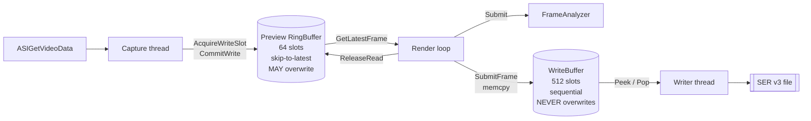

# Capture Pipeline

Two lock-free SPSC ring buffers in series, with different semantics,
because the preview and the recording want opposite things from a full
buffer.



| | Preview `RingBuffer` | `WriteBuffer` |
|---|---|---|
| Consumer reads | Skip to latest | Strictly sequential |
| When full | **Overwrites** the oldest unread frame | **Refuses** and counts an overrun |
| Slot size | Current frame size | Large enough for full-frame RAW16 |
| Default slots | 64 (`DEFAULT_RING_SIZE`) | 512 (`CaptureConfig::writeBufferSlots`) |
| Consumers | Render loop, analyzer | Writer thread only |
| Purpose | Show the newest thing | Lose nothing |

> **Why two buffers rather than one.** A preview that shows a frame from
> two seconds ago is useless, so the preview ring must be allowed to throw
> old frames away. A recording that silently discards frames is worse than
> useless, so the write buffer must never overwrite. One buffer cannot have
> both policies.

---

## The frame slot state machine

[`src/core/FrameSlot.h`](https://github.com/Maligzar/Raduk-Capture/blob/master/src/core/FrameSlot.h)

```
FREE ──> WRITING ──> READY ──> READING ──> FREE
  ^          |                                |
  └──────────┘ (ReleaseWrite, on SDK error)   |
  └───────────────────────────────────────────┘
```

| State | Meaning |
|-------|---------|
| `FREE` | Empty, available to the capture thread |
| `WRITING` | The capture thread is filling it |
| `READY` | Frame data complete, available to a consumer |
| `READING` | A consumer (GUI/analyzer) is actively using it |

> **Why `READING` exists.** Without it, `GetLatestFrame()` returned the
> slot to `FREE` immediately, letting the capture thread overwrite it while
> the renderer was still reading — a use-after-free data race that crashed
> the application. Fixed in Milestone 4. This is the single most important
> state in the pipeline.

```cpp
struct FrameSlot {
    uint8_t*                data;            // VirtualAlloc'd, pre-allocated
    size_t                  bufferCapacity;
    size_t                  dataSize;        // actual bytes this frame
    uint64_t                timestamp;       // QPC microseconds
    uint64_t                frameNumber;     // monotonic
    uint32_t                width, height;
    uint8_t                 bitDepth;        // 8 or 16
    ASI_IMG_TYPE            imgType;
    std::atomic<FrameState> state;
};
```

---

## Preview ring buffer

[`src/core/RingBuffer.h`](https://github.com/Maligzar/Raduk-Capture/blob/master/src/core/RingBuffer.h)

### Allocation

`Allocate(numSlots, frameSizeBytes)` is called once at camera init and
again on any ROI or format change. Each slot's data buffer is a separate
`VirtualAlloc(MEM_COMMIT | MEM_RESERVE, PAGE_READWRITE)` — page-aligned,
and it keeps multi-megabyte long-lived blocks out of the heap. Failure at
any slot deallocates everything and returns `false` rather than running
with a partial ring.

### Producer: `AcquireWriteSlot()`

Scans forward from `m_writePos` for a slot it can claim. **Every claim is a
compare-and-swap**, and the order of attempts is the whole design:

```cpp
// 1. Prefer a FREE slot
FrameState expected = FrameState::FREE;
if (slot->state.compare_exchange_strong(expected, FrameState::WRITING, ...)) {
    m_acquiredOffset = k;
    if (k > 0) m_overruns.fetch_add(1, ...);
    return slot;
}
// 2. Otherwise overwrite an unread READY frame — CAS so a consumer
//    that just claimed it for READING wins and we move on.
expected = FrameState::READY;
if (slot->state.compare_exchange_strong(expected, FrameState::WRITING, ...)) {
    m_acquiredOffset = k;
    m_overruns.fetch_add(1, ...);
    return slot;
}
// 3. READING or WRITING — never stomp; try the next slot.
```

Returns `nullptr` only when every slot is actively in use, and the caller
drops that frame.

> **Why every claim is a CAS (Phase 56, review C1).** The previous code did
> an unconditional `state.store(WRITING)` after a failed CAS, racing the
> consumer's `READY → READING` transition. The consumer could acquire the
> slot between the producer's load and store and have its frame stomped
> mid-read — producing **torn preview frames and torn SER writes**. The
> skip path also desynced `m_writePos` from the slot actually written.

### `m_acquiredOffset` — the subtle part

`CommitWrite()` advances `m_writePos` by `m_acquiredOffset + 1`, not by 1:

```cpp
void CommitWrite(FrameSlot* slot) {
    slot->state.store(FrameState::READY, std::memory_order_release);
    m_writePos.fetch_add(m_acquiredOffset + 1, std::memory_order_release);
    m_acquiredOffset = 0;
    m_totalFrames.fetch_add(1, std::memory_order_relaxed);
}
```

This keeps `(m_writePos − 1) % numSlots` pointing at the slot just written
even when `AcquireWriteSlot` skipped over busy slots — which is exactly
what `GetLatestFrame()`'s newest-first scan depends on. `m_acquiredOffset`
is a plain `int`, not an atomic, because it is producer-thread-only state
in an SPSC buffer.

### Consumer: `GetLatestFrame()` / `ReleaseRead()`

Scans **backwards** from `m_writePos` for the first `READY` slot and CASes
it to `READING`. The caller **must** call `ReleaseRead()` when done, which
stores `FREE`.

A leaked slot is a permanent capacity loss. The render loop's
`ReleaseRead()` is the last statement of the tick for exactly this reason.

### Memory ordering

| Operation | Ordering | Why |
|-----------|----------|-----|
| Claim CAS success | `acquire` | Nothing the producer writes may be hoisted above the claim |
| `CommitWrite` store | `release` | All frame data is visible before `READY` is observable |
| `GetLatestFrame` load of `m_writePos` | `acquire` | Pairs with `CommitWrite`'s release |
| `ReleaseRead` store | `release` | The consumer is finished before the slot is reusable |
| Counters | `relaxed` | Statistics; no synchronisation duty |

---

## Write buffer

[`src/core/WriteBuffer.h`](https://github.com/Maligzar/Raduk-Capture/blob/master/src/core/WriteBuffer.h)

Simpler, because the consumer is strictly sequential: a `ready` flag per
slot plus monotonic `m_writePos` / `m_readPos`.

```cpp
struct WriteSlot {
    uint8_t*          data;
    size_t            bufferCapacity, dataSize;
    uint64_t          timestampUs;
    uint32_t          width, height;
    uint8_t           bitDepth;
    float             sharpness;        // Phase 11: lucky-imaging score 0-100
    uint32_t          cropCX, cropCY;   // Phase 76: where to measure sharpness
    std::atomic<bool> ready;
};
```

`Push()` **memcpy's** the data — the caller's buffer is not retained, which
is what frees the preview slot immediately after submission. `Peek()`
returns the next ready slot or `nullptr`; `Pop()` clears `ready` and
advances the read position.

`SlotCapacity()` exists so the caller can detect that a frame-size change
requires reallocation (review C3) rather than quietly truncating frames
into undersized slots.

### Sizing

At 47 fps × 1.2 MB = ~56 MB/s sustained. 512 slots × 1.2 MB ≈ 600 MB
absorbs about **10 seconds** of complete disk stall. `Pending()` is what
the `BUF` bar in the status panel displays — a rising value means the disk
is not keeping up and an overrun is approaching.

---

## Recording orchestration

[`src/core/CaptureManager.h`](https://github.com/Maligzar/Raduk-Capture/blob/master/src/core/CaptureManager.h)

Note where the recording tap sits: **the capture thread does not know
recording exists.** It only ever feeds the preview ring. `CaptureManager`
taps the ring *from the render loop* — each preview frame is also pushed
into the write buffer when recording is active.

```
StartRecording(w, h, bitDepth)
  ├── allocate WriteBuffer (realloc if slot capacity changed)
  ├── BuildFilePath()  →  prefix_frametype_WxH_RAWn_YYYYMMDD_HHMMSS.ser or .fits
  ├── SERWriter::Open()
  └── start writer thread

SubmitFrame(slot, sharpness, cropCX, cropCY)   [render loop]
  ├── skip if paused
  ├── WriteBuffer::Push()  →  false means overrun, framesDropped++
  └── check limit (frames or seconds) → StopRecording(normal=true)

StopRecording(normal)
  ├── stop accepting frames
  ├── drain the remaining buffer
  ├── SERWriter::Close()   (trailer, frame count, _quality.txt)
  ├── join writer thread
  └── m_onComplete(path, normal)
```

### `CaptureConfig`

| Field | Default | Notes |
|-------|---------|-------|
| `outputDir` | `D:\RadukCapture\captures` | |
| `filePrefix` | `Capture` | From the active profile, e.g. `Jupiter` |
| `frameType` | `Light` | Phase 44: Light / Dark / Flat / Bias |
| `limitType` | `Frames` | or `Time` |
| `limitFrames` | 1000 | |
| `limitTimeSec` | 60.0 | |
| `writeBufferSlots` | 512 | |

### `SetOnComplete` and why "normal" matters

```cpp
void SetOnComplete(std::function<void(const std::string&, bool)> cb);
```

`normal` is true when the user pressed stop or the configured limit was
reached; false for an emergency stop or an ROI change.

> **Why this exists rather than a hook on the stop button.** A planned
> capture ends by hitting its frame count *inside* `SubmitFrame`, not by
> anyone pressing a button — so a hook on the button alone would almost
> never fire in real use. And anything expensive hung off the end of a
> capture (the [AutoStakkert handoff](Image-Analysis#autostakkert-handoff),
> for instance) must only run on a normal finish.

### The quality gate

Applied in the render loop, not in `CaptureManager`:

```cpp
bool seenOk = !gateEnabled
              || !lastAnalysis.valid
              || lastAnalysis.seeingScore >= gateThresh;
```

Note the two bypasses: the gate is open when disabled, and open when there
is no valid analysis yet. A gate that blocked everything before the first
analysis result would simply never start recording. `SetGateActive(true)`
drives the amber "GATED (waiting)" indicator; false shows the green STOP.

---

## Format changes

Since Phase 84 there is **one shared capture-format path** replacing three
divergent copies, at
[`src/main.cpp:1963`](https://github.com/Maligzar/Raduk-Capture/blob/master/src/main.cpp#L1963).
Changing resolution or bit depth:

1. Closes any current recording — **a SER file cannot change format
   part-way through**, and the remainder would be unreadable.
2. Reconfigures the camera and reads back the *granted* size.
3. Reallocates the preview ring and, if slot capacity changed, the write
   buffer.
4. Places the ROI **by centre, not by origin**, so widening the field to
   find a planet that drifted out does not also move the field somewhere
   else.
5. Opens a new file at the new format if recording was active.

The `FULL` toolbar button exists because a crop used to be a one-way door:
`[ROI]` and a dragged box both narrow the sensor read-out, and until v1.2.3
nothing widened it again short of restarting the application.

---

**Next:** [Recording and SER Format](Recording-and-SER-Format) · [Image Analysis](Image-Analysis) · [Threading Model](Threading-Model)
