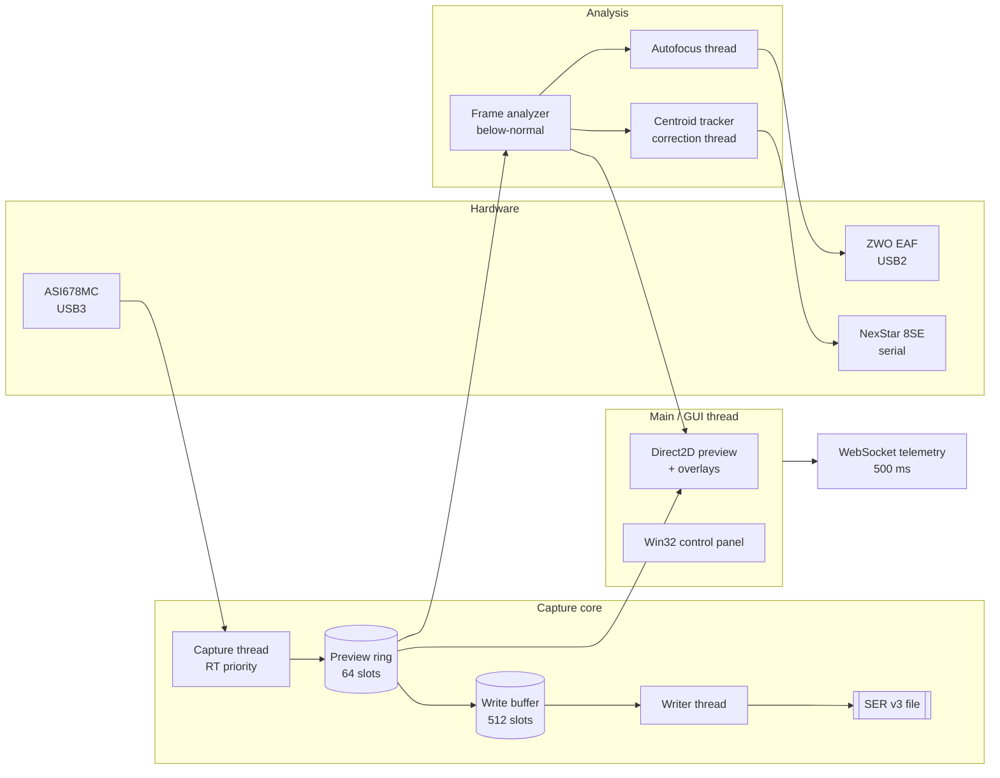

# RadukCapture

High-speed planetary capture suite for Windows. Pure Win32 + Direct2D, no
frameworks, ~44,754 lines of C++ across 100 source files. Built for a
Celestron NexStar 8SE + ZWO ASI678MC + ZWO EAF, talking to each device
directly: the ASI SDK for the camera, the EAF SDK for the focuser, and the
raw NexStar serial command set for the mount. No ASCOM, no CPWI, no
intermediary.

This wiki is the deep reference: what each subsystem does, why it is built
the way it is, and where in the source to look. It is derived from the
source tree, [`RadukCapture-Architecture.md`](https://github.com/Maligzar/Raduk-Capture/blob/master/RadukCapture-Architecture.md)
and [`RadukCapture-Help.md`](https://github.com/Maligzar/Raduk-Capture/blob/master/RadukCapture-Help.md).

---

## Start here

| If you want to | Read |
|----------------|------|
| Understand what this is and why it exists | **[Overview](Overview)** |
| Build and run it tonight, with or without hardware | **[Getting Started](Getting-Started)** |
| See how the whole thing fits together | **[Architecture Overview](Architecture-Overview)** |
| Find the file that owns a behaviour | **[Code Map](Code-Map)** |
| Operate the rig on a real night | **[Operations Guide](Operations-Guide)** |
| Fix something that is not working | **[Troubleshooting](Troubleshooting)** |

---

## The map

### Foundations
- **[Overview](Overview)** — purpose, design philosophy, target hardware, two-machine setup
- **[Getting Started](Getting-Started)** — CMake, both build configurations, first launch
- **[Architecture Overview](Architecture-Overview)** — layer map, window architecture, data flow
- **[Threading Model](Threading-Model)** — six threads, who owns what, the handoff rules

### The capture path
- **[Capture Pipeline](Capture-Pipeline)** — ring buffer, write buffer, the lock-free state machines
- **[Recording and SER Format](Recording-and-SER-Format)** — SER v3 on disk, timestamp trailer, per-frame quality scores
- **[Image Analysis](Image-Analysis)** — histograms, sharpness, seeing score, the quality gate, quick-look stacking, dark/flat masters

### The hardware
- **[Device Layer](Device-Layer)** — `IMount`, camera and focuser wrappers, compile-time device selection, USB arbitration
- **[Mount Control](Mount-Control)** — NexStar serial, watchdog, cord-wrap tracking, keep-out sector
- **[Tracking and Guiding](Tracking-and-Guiding)** — three-stage acquisition and measured guide calibration
- **[Autofocus](Autofocus)** — V-curve scan, local parabola fit, and the revert that makes it honest

### Sky and intelligence
- **[Sky, GoTo and Plate Solving](Sky-GoTo-and-Plate-Solving)** — catalog, polar sky map, ASTAP, pointing model
- **[Advisors](Advisors)** — atmospheric dispersion, auto-exposure, readiness check, unprompted advice
- **[AI Assistant](AI-Assistant)** — local Ollama client, context assembly, object knowledge base

### Presentation and remote
- **[Rendering and UI](Rendering-and-UI)** — Direct2D preview, overlays, night vision, control panel
- **[Telemetry and Dashboard](Telemetry-and-Dashboard)** — RFC 6455 server, APEX JSON, remote commands

### Reference
- **[Configuration Reference](Configuration-Reference)** — `rig.ini`, target profiles, every key
- **[Emulator and Testing](Emulator-and-Testing)** — full device simulation and its environment switches
- **[Operations Guide](Operations-Guide)** — first night, keyboard map, file layout
- **[Troubleshooting](Troubleshooting)** — symptom to cause to fix
- **[Code Map](Code-Map)** — every source file and what owns it
- **[Roadmap and Phase History](Roadmap-and-Phase-History)** — what is built, what is not, in what order
- **[Glossary](Glossary)** — the domain vocabulary

---

## The shape of the thing in one diagram

---

## Conventions in this wiki

- Source references look like `src/core/RingBuffer.h:106` and link to the
  file on `master`. Line numbers are accurate as of the revision this wiki
  was generated from; treat them as a starting point, not a contract.
- **Why it is this way** boxes carry design rationale lifted from the
  source comments. The codebase documents its own reasoning unusually
  well, and that reasoning is the most valuable thing in it.
- Numbers presented as constants (`S3_MAX_PULSE_MS = 500`) come from the
  source. Numbers describing the rig (plate scale, sensor specs) come from
  the hardware and are stated as such.
