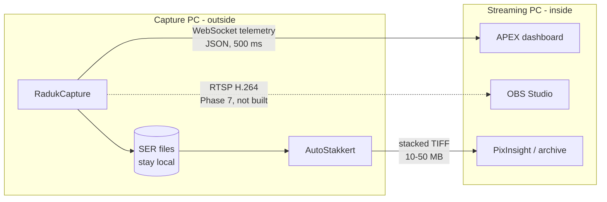

# Overview

**What it is:** a single-process planetary capture application that owns the
whole chain — sensor readout, mount control, focus, plate solving, quality
scoring, and session logging — in one address space, on one machine, with no
intermediary drivers.

**Who it is for:** one observer with one specific rig, plus anyone whose rig
is close enough that the constants in [`rig.ini`](Configuration-Reference)
cover the difference.

---

## Why build this when other astronomy and planetary imaging applications already exist?

The stated reason is coherence. From
[`RadukCapture-Architecture.md`](https://github.com/Maligzar/Raduk-Capture/blob/master/RadukCapture-Architecture.md):

> RadukCapture exists because the astronomy stack — capture, mount control,
> plate solving, weather-aware scoring, and eventually AI-assisted operation
> — should be one coherent system, not five separate concerns reconciled by
> hand every session.

Five concrete consequences of that, each of which shows up in the code:

**Unified state.** Pixels, mount position, plate solves, and quality scores
live in one process, so a capture decision is made from one live picture of
the system rather than reassembled from logs afterwards. The
[AI context builder](AI-Assistant) is the clearest expression of this: it
can hand a language model the camera settings, the mount position, which
display modes are altering the image, and tonight's imaging windows, in one
snapshot, because all of it is already in scope.

**Direct hardware integration.** The ASI678MC's full-frame RAW16 stream is
~1.5 GB/s. Native SDK access and direct NexStar serial give the
[capture pipeline](Capture-Pipeline) the zero-copy, low-latency path that
rate requires, and give the [tracking loop](Tracking-and-Guiding) guide
pulses without a COM round trip.

**Instrument-specific tuning.** Exposure logic, quality gating, and the
dispersion model are built around a 2032 mm f/10 single-arm alt-az mount at
0.203″/px, not generalised for an average setup. Where a constant is
rig-dependent it lives in [`rig.ini`](Configuration-Reference) rather than
being averaged away.

**A foundation for what does not exist yet.** Pointing-model learning from
repeated plate solves and an assistant with growing autonomy over the
capture loop both require the application's internals to be addressable
from the start.

**Full ownership of the data.** Session logs, per-frame quality metrics, and
pointing corrections are written in a schema designed for how the data will
be used — archival, context building, dashboard scoring — not adapted from
someone else's log format.

---

## Design philosophy, as the code actually practises it

Four principles recur throughout the source, and they are worth stating
because they explain decisions that would otherwise look arbitrary.

### Measure, do not assume

The guide calibration measures camera rotation, plate scale, and guide rate
by pulsing the mount and watching the centroid move
([Tracking and Guiding](Tracking-and-Guiding)). The nominal plate scale in
`rig.ini` seeds overlays and solver hints only — the correction loop never
uses it. Tracking state is confirmed by readback, not by command
acknowledgement. The atmospheric dispersion model computes across the band
of the filter *actually fitted*, because a hardcoded 450–700 nm silently
assumed a UV/IR cut was in place.

### Report honestly, including failure

Autofocus re-measures sharpness after moving and reverts to the start
position if it made focus worse, reporting failure
([Autofocus](Autofocus)). The pointing map reports its correction and
declines to apply it, with reasons. The centroid tracker distinguishes "the
planet is too faint" from "there is nothing in frame", because those need
opposite responses from the observer. `TrackingModeKnown()` exists so an
unreadable mount state reads `UNKNOWN` instead of the materially different
claim `OFF`.

### Silence when there is nothing to say

The [readiness check](Advisors) appears only on a failure; a list that
appears every launch becomes a speed bump within a week. The
[advisory loop](Advisors) is asked at most once per interval, never while
recording, only when rig state has changed, and its "OK" answer is
swallowed.

### Never let the model decide

The advisory loop's first version handed rig state to a 3B model and asked
for advice. It answered confidently and wrongly. So the *caller* detects
conditions in code, where they are deterministic and checkable, and the
model is given those concerns and asked only to phrase one. `AdvisoryLoop`
holds no reference to the camera, mount, focuser, or capturer — it produces
a `std::string` and cannot act on the rig even if asked to. That is the
whole safety argument, and it is why the class is shaped that way.

---

## Target hardware

| Component | Spec |
|-----------|------|
| Imaging machine | Windows, Intel i9, discrete GPU |
| Camera | ZWO ASI678MC |
| Sensor | Sony IMX678 — 3840×2160, 1/1.8″, 2 µm pixels, STARVIS 2 |
| Bayer pattern | RGGB |
| Bit depth | 8-bit / 12-bit (stored as 16-bit) |
| Max frame rate | ~47.5 fps at full res RAW8, ~24 fps RAW16 |
| Peak throughput | ~1.5 GB/s (RAW16 full frame) |
| HCG threshold | Gain ≥ 182 — read noise drops ~3.5 e⁻ → 0.8 e⁻ |
| Unity gain | ~100 (noisy; avoided for planets) |
| Full well | 11,270 e⁻ (keep histogram 50–70%) |
| Focuser | ZWO EAF, USB 2.0, 0–600,000 steps, absolute positioning, temperature sensor, backlash compensation |
| Real focus position | ~168,187 steps on this rig |
| Mount | Celestron NexStar 8SE, alt-az, StarSense AutoAlign |
| Optics | 2032 mm f/10 (C8) |
| Plate scale | 206.265 × 2 µm / 2032 mm ≈ **0.203″/px** |
| Field of view | 12.99′ × 7.31′ at 1280×960 crop; 0.13° circle on the sky map |
| Mount interface | USB-to-serial via StarSense hand control, NexStar RS-232 command set |
| Slew rates | 1–9 (1× to 3°/s); jog buttons use rate 9 |

Sensor and focuser facts are collected in
[`src/profiles/TargetProfile.h`](https://github.com/Maligzar/Raduk-Capture/blob/master/src/profiles/TargetProfile.h)
alongside the hardware rails every profile value is clamped to. See
[Configuration Reference](Configuration-Reference).

---

## Two-machine setup

The application is designed around a capture machine outside with the
telescope and a monitoring machine inside the house.

| Machine | Role | Location |
|---------|------|----------|
| Imaging PC | Runs RadukCapture, connected to all hardware | Outside with the telescope |
| Monitoring PC | Runs the APEX dashboard and OBS Studio | Inside |

Raw SER never crosses the network — it stays on the capture PC, stacks on
the capture PC, and only the finished stack transfers. Telemetry payloads
are tiny and work over WiFi. The RTSP preview stream is designed but not
built; see [Roadmap and Phase History](Roadmap-and-Phase-History).

The telemetry server binds **loopback only** by default. Set
`RADUK_WS_LAN=1` to expose it on a trusted LAN. See
[Telemetry and Dashboard](Telemetry-and-Dashboard).

---

## What is deliberately not built

Worth stating up front so nobody goes looking:

- **Full stacking.** Out of scope. AutoStakkert does multi-point alignment
  and drizzle better, it is free, and nothing here would beat it. The
  [quick-look stacker](Image-Analysis) exists to answer "is this sharp"
  at the telescope, not to produce the final image. Phase 77 added the
  handoff instead.
- **Calibration frames in the recording.** Dark and flat correction is a
  **preview aid only** — the recorded SER stays raw. See
  [Image Analysis](Image-Analysis).
- **Output formats beyond SER.** No AVI, no FITS. The plate solver reads
  FITS; nothing here writes it.
- **ADC alignment.** The [advisor](Advisors) tells you how much dispersion
  there is and whether a corrector is worth fitting. It does not help you
  dial one in.

The full list is in [Roadmap and Phase History](Roadmap-and-Phase-History).

---

**Next:** [Getting Started](Getting-Started) · [Architecture Overview](Architecture-Overview)
