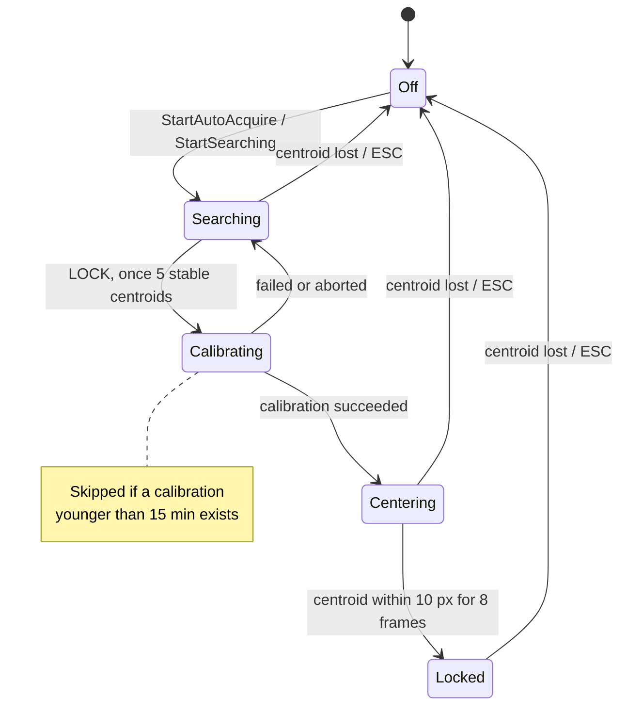

# Tracking and Guiding

Closed-loop planetary tracking: find the planet, measure how the mount
responds to a pulse, then keep it centred using that measurement. The
headline property is that **nothing is assumed** — not the camera's
rotation, not the plate scale, not the guide rate.

[`src/core/CentroidTracker.h`](https://github.com/Maligzar/Raduk-Capture/blob/master/src/core/CentroidTracker.h) ·
[`.cpp`](https://github.com/Maligzar/Raduk-Capture/blob/master/src/core/CentroidTracker.cpp)

---

## The state machine



| Stage | Corrections | What it does |
|-------|-------------|--------------|
| `Off` | none | Nothing active |
| `Searching` | none | Full frame, analyzer hunts the brightest object. Needs `STABLE_FRAMES = 5` consecutive valid centroids before LOCK activates |
| `Calibrating` | measurement pulses | PHD2-style: pulse East, measure displacement, pulse back; pulse North, measure, pulse back. Derives the 2×2 pixel→pulse transform |
| `Centering` | slow | Pulls the planet towards centre. Dwell: within `CENTRE_THRESHOLD_PX = 10` for `DWELL_FRAMES = 8` consecutive frames |
| `Locked` | fine | Caller crops the sensor ROI to 1280×960 centred on the planet. Same transform, higher aggressiveness |

### One-button acquisition

`StartAutoAcquire(std::string& whyNot)` — Phase 65.

> **Why it exists.** This previously took three button presses (CENTROID,
> then LOCK once five centroids had accumulated, then ROI once the dwell
> was met) and **each silently did nothing when its precondition was
> unmet**, so a refusal was indistinguishable from a dead button.

It returns `false` with a reason the caller can display. The tracking check
is the important one:

> With the mount not driving, the planet crosses the 10 px dwell window in
> **0.14 s**, so Centering can never converge, and calibration measures
> about **four times more drift than pulse response**. Every stage
> downstream fails, and none of them can say why.

---

## Guide calibration

The core idea: do not assume how a pulse moves the image — measure it.

```cpp
struct GuideCalibration {
    bool  valid = false;
    float exPerMs, eyPerMs;   // measured East-pulse response, px per ms
    float nxPerMs, nyPerMs;   // measured North-pulse response, px per ms
    float arcsecPerPx;        // derived, display/deadband only
    float altDeg;             // altitude at calibration (<0 = unknown)
    std::chrono::steady_clock::time_point when;
};
```

That 2×2 matrix absorbs **camera rotation, plate scale, guide rate, and
mount axis geometry simultaneously** — none of which have to be known
separately, and all of which would otherwise be four opportunities to be
wrong.

### Parameters

| Constant | Value | Meaning |
|----------|-------|---------|
| `CAL_PULSE_MS` | 800 | Per calibration pulse |
| `CAL_SAMPLES` | 4 | Centroids averaged per measurement |
| `CAL_SETTLE_MS` | 700 | Post-pulse settle before measuring |
| `CAL_STEP_TIMEOUT_MS` | 8000 | Max wait for samples per step |
| `CAL_MIN_MOVE_PX` | 2.5 | Minimum measurable pulse response |
| `CAL_MIN_SIN_ANGLE` | 0.25 | Axes must be more than ~15° apart |
| `CAL_STALE_MIN` | 15 | Minutes before a calibration is refreshed |

### Why calibration deliberately does not persist

> Alt-az field rotation slowly invalidates the transform. A calibration
> younger than `CAL_STALE_MIN` is reused within a session, but nothing is
> written to disk — a transform measured last night is wrong tonight, and a
> stale-but-plausible matrix is worse than no matrix, because the loop will
> confidently correct in the wrong direction.

`_WaitCentroidAvg()` averages `CAL_SAMPLES` **distinct** analyzer results —
`lastTime` must change between samples. Re-reading the same result four
times would look like four agreeing measurements of a value sampled once.

### The guide-rate measurement, and why it is reported

The calibration derives the *actual* guide rate and compares it with
`rig.ini`:

```cpp
cal.arcsecPerPx = RigConfig::Get().plateScaleArcsecPx;
float measured  = (eMag * cal.arcsecPerPx) / (CAL_PULSE_MS / 1000.0f);
```

> **Note the direction of the derivation.** An earlier version did this
> backwards: it pinned a known number (plate scale, computable from the
> optics) to an unverified one (guide rate, a firmware behaviour), so every
> arcsecond the user read scaled with that assumption. Taking the scale as
> given and *deriving* the rate means a measured rate far from the assumed
> value immediately explains any mis-sized pulse, instead of hiding inside
> the displayed figures.
>
> The correction solve is unaffected either way: it works in the pixel
> domain from the measured px/ms matrix, where the rate cancels out.

A disagreement beyond 2× in either direction appends a blunt warning to the
user-visible calibration message:

```
E=(12.4,0.8)px/s N=(0.6,-11.9)px/s scale=0.20"/px alt=47
  guide rate measured 2.51"/s vs rig.ini 7.50"/s <- WRONG, set GuideRateArcsecPerSec
```

> **Why that text is in the message rather than a `printf`.** `printf`
> reaches nothing in a GUI build, so the one diagnostic that says
> `rig.ini`'s guide rate is wrong — which throws off pulse sizing and the
> drift readout — was invisible to the only person who could act on it. A
> measurement that disagrees with configuration is the most useful thing
> this routine learns, and it is only actionable if it is seen.

---

## The correction solve

Corrections are solved **purely in the pixel domain**. Pulse durations
`(tE, tN)` satisfy:

```
M · (tE, tN) = −error_px × aggressiveness
```

where `M`'s columns are the measured East and North responses in px/ms.

```cpp
float det = exMs * cal.nyPerMs - cal.nxPerMs * eyMs;
if (std::abs(det) < 1e-8f || eMag2 <= 0 || nMag2 <= 0) continue;   // degenerate

float tE = ( cal.nyPerMs * ddx - cal.nxPerMs * ddy) / det;
float tN = (-eyMs        * ddx + exMs        * ddy) / det;
```

A **negative duration flips to the opposite direction** — West instead of
East, South instead of North. That is what makes a single measured matrix
sufficient; there is no need to calibrate all four directions.

### The alt-az cosine rescale

On an alt-az mount the azimuth axis covers less sky per degree as altitude
increases. The East column is rescaled as altitude changes:

```cpp
float cCal = std::cos(cal.altDeg * 0.01745329f);
float cNow = std::cos(lastAltDeg * 0.01745329f);
// East (azimuth) response scaled by cNow / cCal
```

Altitude is refreshed occasionally from the mount during the loop, not on
every cycle — it changes slowly and reading it costs a serial round trip.

### Averaged input, not latest sample

Phase 53. Corrections act on the centroid **averaged over
`AVG_WINDOW_MS = 1000`**, with `AVG_MIN_SAMPLES = 2`, not the latest
sample.

> **Why.** Raw planetary centroids jitter 2–5″ with seeing, and a
> proportional loop fed raw samples **chases that noise**. The deadbands
> apply to the averaged position.

This is the planetary-specific insight: the error signal and the seeing
noise live at similar amplitudes, so averaging is not a refinement, it is
the difference between a loop that converges and one that oscillates.

### Stage parameters

| | Centering (Stage 2) | Locked (Stage 3) |
|---|---|---|
| Aggressiveness | 0.20 | 0.50 |
| Max pulse | 200 ms | 500 ms |
| Deadband | 2.0″ | 2.5″ |
| Loop rate | 500 ms | 250 ms |

> **The deadband must stay below `CENTRE_THRESHOLD_PX`** on the real rig
> (10 px ≈ 2″ at 0.203″/px) or the dwell condition could never be reached —
> the loop would stop correcting while still outside the window it is
> waiting to enter.

### Actual versus configured cadence

`S3_RATE_MS = 250` sets the loop **wake-up** rate. But on the NexStar
backend [`PulseGuide` blocks](Mount-Control#pulseguide) for the pulse
duration, so a Locked cycle firing both axes takes up to:

```
S3_RATE_MS + 2 × (maxPulse + 50)  ≈  1.35 s worst case
```

The effective correction rate is **~1–4 Hz, not a fixed 4 Hz**. Worth
knowing before concluding the loop is sluggish.

---

## Thread safety

All shared state passes through one `m_mutex`. The correction thread reads
only via `GetSnapshot()`:

```cpp
struct Snapshot {
    float    cx, cy;          // latest sample
    float    avgX, avgY;      // Phase 53 window average
    int      nAvg;
    uint32_t fw, fh;
    bool     valid, everSeen;
    std::chrono::steady_clock::time_point lastTime;
    IMount*  mount;
};
```

One lock acquisition copies everything the loop needs, so a correction is
never computed from half-updated state.

### Stage transition ownership

| Transition | Thread |
|------------|--------|
| To/from `Off` | Main |
| `Calibrating` → `Centering` | **Correction** |
| `Calibrating` → `Searching` | **Correction** |

The main thread only *observes* the middle two — which is why `m_calPending`
and `m_calSuccess` exist. The correction thread completes a calibration and
raises a flag; `Tick()` on the main thread fires the user-facing callback.

### The one caller rule that matters

```cpp
// Feed from main thread, ONCE PER NEW ANALYSIS RESULT.
bool SubmitCentroid(float cx, float cy, uint32_t fw, uint32_t fh);
```

> **Do not re-submit a stale result.** Every call refreshes the
> centroid-loss timeout, so re-submitting defeats the 2 s safety cutoff and
> inflates the stable and dwell counters. A loop that re-submits each render
> frame would reach `DWELL_FRAMES` in 0.2 s without the planet having
> settled at all.

---

## Safety

| Trigger | Response |
|---------|----------|
| Centroid lost at any stage | `m_lostPending` set → main thread calls `Reset()` |
| Centroid timeout (`CENTROID_TIMEOUT_MS = 2000`) | Treated as lost |
| Mount jog | `SuspendCorrections()` — also **aborts an active calibration** |
| `ESC` | `Reset()` |
| Degenerate calibration matrix | Correction skipped, not applied blindly |

Jog suspension covers the jog plus a 500 ms settle. A calibration
interrupted by a jog is discarded rather than completed from mixed data.

### Why a centroid loss is reported with a reason

Phase 69 split loss into two cases:

```cpp
void SubmitCentroidLost(bool tooFaint = false, int peak = -1);
std::string CentroidBlockReason() const;
```

Producing user-visible text like:

```
SEARCHING - planet too faint to detect (frame peak 3%, needs above 8%)
```

> "Too faint" and "nothing in frame" need **opposite responses** from the
> user — raise exposure versus go and find it — and the gate used to report
> them identically, silently.

The acquisition stage and its blocker are shown **continuously** in the
TELESCOPE panel (Phase 70), updating on their own rather than only when
something is pressed.

---

## ROI crop on lock

When Stage 3 engages, the caller switches the sensor ROI to 1280×960
centred on the last known centroid, aligned to ASI constraints — **width a
multiple of 8, height a multiple of 2**. Since Phase 84 this goes through
the one shared capture-format path and is placed **by centre, not by
origin**, so a later widening to `FULL` keeps the planet in the middle. See
[Capture Pipeline](Capture-Pipeline#format-changes).

---

## Testing it without a telescope

The emulator closes the loop end to end (Phase 52): `MountEmulator` models
a fixed sky target, exposes the pointing error, and `CameraEmulator` renders
the planet displaced by it. Guide pulses move the mount, the error shrinks,
the planet re-centres.

Set `RADUK_EMU_ROTATION_DEG` to a non-zero value to prove the tracker
**measures** its axis transform rather than assuming it — a tracker that
assumed camera orientation would correct in the wrong direction and fail
visibly. See [Emulator and Testing](Emulator-and-Testing).

---

**Next:** [Autofocus](Autofocus) · [Mount Control](Mount-Control) · [Image Analysis](Image-Analysis)
